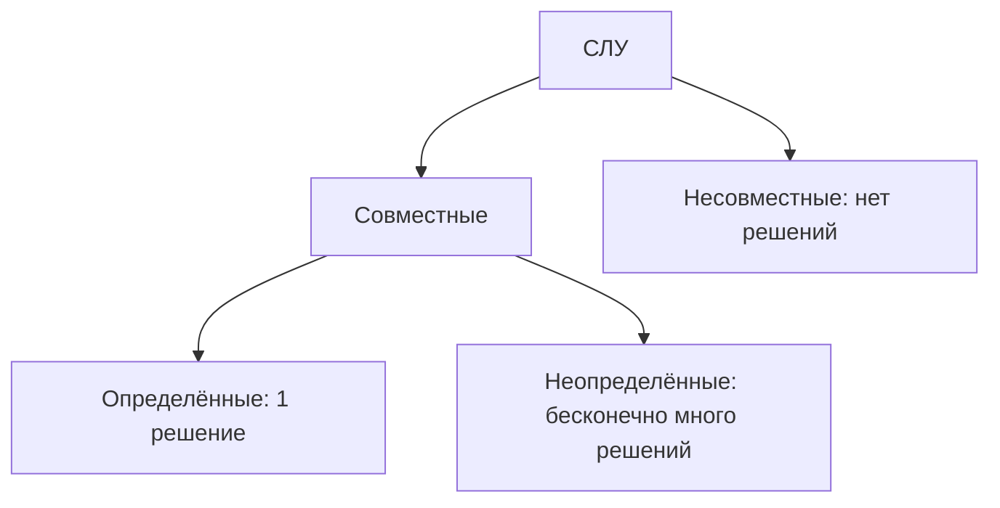

# Системы линейных уравнений (СЛУ)

| Предмет | Тема занятия | Дата |
| :--- | :--- | :--- |
| Линейная алгебра | СЛУ, классификация, метод Крамера; обратная матрица, матричный метод, метод Гаусса и метод Жордана-Гаусса | 16.09.2026, 30.09.2026, 07.10.2026 |

Теги: #линейная_алгебра #слу #метод_крамера #обратная_матрица #метод_гаусса #метод_жордана_гаусса #лекция

## Содержание

- [Основные определения](#основные-определения)
- [Классификация систем](#классификация-систем)
- [Метод Крамера](#метод-крамера)
  - [Алгоритм метода Крамера](#алгоритм-метода-крамера)
  - [Пример решения СЛУ методом Крамера](#пример-решения-слу-методом-крамера)
- [Обратная матрица](#обратная-матрица)
  - [Определение](#определение)
  - [Нахождение обратной матрицы](#нахождение-обратной-матрицы)
  - [Пример 1](#пример-1)
  - [Формула для матрицы размера 2 на 2](#формула-для-матрицы-размера-2-на-2)
- [Решение СЛУ матричным методом](#решение-слу-матричным-методом)
  - [Пример 2](#пример-2)
- [Метод Гаусса](#метод-гаусса)
  - [Особенности метода](#особенности-метода)
  - [Элементарные преобразования](#элементарные-преобразования)
  - [Цель](#цель)
  - [Пример 3](#пример-3)
  - [Пример 4. Система без решений](#пример-4-система-без-решений)
  - [Пример 5. Бесконечно много решений (одна свободная переменная)](#пример-5-бесконечно-много-решений-одна-свободная-переменная)
  - [Пример 6. Бесконечно много решений (две свободные переменные)](#пример-6-бесконечно-много-решений-две-свободные-переменные)
- [Классификация СЛУ (сводка)](#классификация-слу)
- [Метод Жордана-Гаусса](#метод-жордана-гаусса)
  - [Пример 7](#пример-7)
- [Нахождение обратной матрицы методом Жордана-Гаусса](#нахождение-обратной-матрицы-методом-жордана-гаусса)
  - [Пример 8](#пример-8)

---
## Основные определения
 
**Системой линейных алгебраических уравнений (СЛУ)** называется система вида:
 
```math
\begin{cases}
a_{11}x_1 + a_{12}x_2 + \dots + a_{1n}x_n = b_1 \\
a_{21}x_1 + a_{22}x_2 + \dots + a_{2n}x_n = b_2 \\
\vdots \\
a_{m1}x_1 + a_{m2}x_2 + \dots + a_{mn}x_n = b_m
\end{cases}
```
 
Где:
 
* $a_{11}, \dots, a_{mn}$ — коэффициенты системы;
* $x_1, \dots, x_n$ — переменные (неизвестные);
* $b_1, \dots, b_m$ — свободные члены.
**Решением системы** называется любой набор переменных $(x_1, x_2, \dots, x_n)$, удовлетворяющий каждому уравнению данной системы.
 
## Классификация систем
 
* **Совместная система** — если решение системы существует.
* **Несовместная система** — если решения нет.
* **Определенная система** — совместная система, которая имеет ровно одно решение.
* **Неопределенная система** — совместная система, которая имеет бесконечно много решений.
## Метод Крамера
 
Метод Крамера применим только для систем из $n$ уравнений и $n$ переменных.
 
### Алгоритм метода Крамера
 
1. Вычисляем главный определитель системы $\Delta$, состоящий из коэффициентов при переменных:
```math
\Delta = \begin{vmatrix} a_{11} & a_{12} & \dots & a_{1n} \\ a_{21} & a_{22} & \dots & a_{2n} \\ \vdots & \vdots & \ddots & \vdots \\ a_{n1} & a_{n2} & \dots & a_{nn} \end{vmatrix}
```
 
* Если $\Delta = 0$, то метод Крамера **неприменим**.
* Если $\Delta \neq 0$, то система является **совместной и определенной**.
2. Вычисляем дополнительные определители $\Delta_i$ ($i = 1, \dots, n$) путём замены $i$-го столбца в главном определителе $\Delta$ на столбец свободных членов.
3. Находим неизвестные по формулам Крамера:
```math
x_i = \frac{\Delta_i}{\Delta}, \quad i = 1, \dots, n
```
 
## Пример решения СЛУ методом Крамера
 
Решить систему уравнений:
 
```math
\begin{cases} x_1 - 2x_2 = 7 \\ 2x_1 + 5x_2 = 10 \end{cases}
```
 
**Решение:**
 
1. Находим главный определитель $\Delta$:
```math
\Delta = \begin{vmatrix} 1 & -2 \\ 2 & 5 \end{vmatrix} = 1 \cdot 5 - (-2) \cdot 2 = 5 + 4 = 9 \neq 0
```
 
Система совместна и определена.
 
2. Вычисляем вспомогательные определители $\Delta_1$ и $\Delta_2$:
```math
\Delta_1 = \begin{vmatrix} 7 & -2 \\ 10 & 5 \end{vmatrix} = 7 \cdot 5 - (-2) \cdot 10 = 35 + 20 = 55
```
 
```math
\Delta_2 = \begin{vmatrix} 1 & 7 \\ 2 & 10 \end{vmatrix} = 1 \cdot 10 - 7 \cdot 2 = 10 - 14 = -4
```
 
3. Находим неизвестные $x_1$ и $x_2$:
```math
x_1 = \frac{\Delta_1}{\Delta} = \frac{55}{9}
```
 
```math
x_2 = \frac{\Delta_2}{\Delta} = -\frac{4}{9}
```
 
**Ответ:** $x_1 = \frac{55}{9}$, $x_2 = -\frac{4}{9}$.
 

---

## Обратная матрица

### Определение

Пусть $`A`$ — квадратная матрица. Матрица $`A^{-1}`$ называется обратной к $`A`$, если

```math
A \cdot A^{-1} = A^{-1} \cdot A = E
```

### Нахождение обратной матрицы

#### Шаг 1

Находим определитель $`\lvert A \rvert`$.

- Если $`\lvert A \rvert = 0`$, то $`A^{-1}`$ не существует. Такая матрица называется вырожденной (особенной, необратимой).
- Если $`\lvert A \rvert \ne 0`$, то $`A^{-1}`$ существует. Такая матрица называется невырожденной (обратимой).

#### Шаг 2

Находим алгебраическое дополнение к каждому элементу матрицы: $`A_{ij} = (-1)^{i+j} M_{ij}`$, где $`M_{ij}`$ — минор, то есть определитель, который остаётся после вычёркивания строки $`i`$ и столбца $`j`$. Из них составляем матрицу алгебраических дополнений:

```math
\tilde{A} = \begin{pmatrix} A_{11} & A_{12} & \dots & A_{1n} \\ \vdots & \vdots & \ddots & \vdots \\ A_{n1} & A_{n2} & \dots & A_{nn} \end{pmatrix}
```

#### Шаг 3

Обратная матрица равна:

```math
A^{-1} = \frac{1}{\det A} \cdot \tilde{A}^{T}
```

### Пример 1

Найти обратную матрицу для $`A = \begin{pmatrix} 2 & 4 \\ 1 & 3 \end{pmatrix}`$.

#### Шаг 1

```math
\det A = 2 \cdot 3 - 4 \cdot 1 = 6 - 4 = 2 \ne 0
```

Определитель не равен нулю, значит, обратная матрица $`A^{-1}`$ существует.

#### Шаг 2

Алгебраические дополнения: $`A_{11} = 3`$, $`A_{12} = -1`$, $`A_{21} = -4`$, $`A_{22} = 2`$.

```math
\tilde{A} = \begin{pmatrix} 3 & -1 \\ -4 & 2 \end{pmatrix}
```

#### Шаг 3

```math
A^{-1} = \frac{1}{\det A} \cdot \tilde{A}^{T} = \frac{1}{2} \cdot \begin{pmatrix} 3 & -4 \\ -1 & 2 \end{pmatrix}
```

#### Проверка

```math
A \cdot A^{-1} = \begin{pmatrix} 2 & 4 \\ 1 & 3 \end{pmatrix} \cdot \frac{1}{2} \begin{pmatrix} 3 & -4 \\ -1 & 2 \end{pmatrix} = \frac{1}{2} \begin{pmatrix} 2 & 0 \\ 0 & 2 \end{pmatrix} = \begin{pmatrix} 1 & 0 \\ 0 & 1 \end{pmatrix} = E
```

### Формула для матрицы размера 2 на 2

Для матрицы $`A = \begin{pmatrix} a & b \\ c & d \end{pmatrix}`$ при условии $`\lvert A \rvert = ad - bc \ne 0`$:

```math
A^{-1} = \frac{1}{\det A} \cdot \begin{pmatrix} d & -b \\ -c & a \end{pmatrix}
```

## Решение СЛУ матричным методом

Рассмотрим систему линейных уравнений (СЛУ) из $`m`$ уравнений с $`n`$ неизвестными:

```math
\begin{cases} a_{11}x_1 + a_{12}x_2 + \dots + a_{1n}x_n = b_1 \\ a_{21}x_1 + a_{22}x_2 + \dots + a_{2n}x_n = b_2 \\ \dots \\ a_{m1}x_1 + a_{m2}x_2 + \dots + a_{mn}x_n = b_m \end{cases}
```

Здесь:

- матрица СЛУ:

```math
A = \begin{pmatrix} a_{11} & a_{12} & \dots & a_{1n} \\ a_{21} & a_{22} & \dots & a_{2n} \\ \vdots & \vdots & \ddots & \vdots \\ a_{m1} & a_{m2} & \dots & a_{mn} \end{pmatrix}
```

- вектор переменных:

```math
\vec{x} = \begin{pmatrix} x_1 \\ x_2 \\ \vdots \\ x_n \end{pmatrix}
```

- вектор свободных членов:

```math
\vec{b} = \begin{pmatrix} b_1 \\ b_2 \\ \vdots \\ b_m \end{pmatrix}
```

Матричный вид СЛУ:

```math
A\vec{x} = \vec{b}
```

Матричный метод применим, когда матрица $`A`$ квадратная. Если $`\lvert A \rvert \ne 0`$, то существует $`A^{-1}`$. Умножим матричное уравнение на $`A^{-1}`$ слева:

```math
A^{-1} \cdot A\vec{x} = A^{-1} \cdot \vec{b} \quad \Rightarrow \quad E\vec{x} = A^{-1} \cdot \vec{b} \quad \Rightarrow \quad \vec{x} = A^{-1} \cdot \vec{b}
```

### Пример 2

Решить систему матричным методом:

```math
\begin{cases} x_1 - x_2 + 2x_3 = -3 \\ 2x_1 + x_2 = 2 \\ x_1 + 3x_2 - x_3 = 3 \end{cases}
```

Запишем систему в виде $`A\vec{x} = \vec{b}`$:

```math
A = \begin{pmatrix} 1 & -1 & 2 \\ 2 & 1 & 0 \\ 1 & 3 & -1 \end{pmatrix}, \qquad \vec{b} = \begin{pmatrix} -3 \\ 2 \\ 3 \end{pmatrix}, \qquad \vec{x} = \begin{pmatrix} x_1 \\ x_2 \\ x_3 \end{pmatrix}
```

#### Шаг 1

Считаем определитель по правилу треугольников:

```math
\det A = 1 \cdot 1 \cdot (-1) + (-1) \cdot 0 \cdot 1 + 2 \cdot 2 \cdot 3 - 2 \cdot 1 \cdot 1 - (-1) \cdot 2 \cdot (-1) - 1 \cdot 0 \cdot 3 = -1 + 0 + 12 - 2 - 2 - 0 = 7 \ne 0
```

Определитель не равен нулю, значит, система определена и совместна, а матрица $`A^{-1}`$ существует.

#### Шаг 2

Находим алгебраические дополнения:

```math
A_{11} = \begin{vmatrix} 1 & 0 \\ 3 & -1 \end{vmatrix} = -1, \qquad A_{12} = -\begin{vmatrix} 2 & 0 \\ 1 & -1 \end{vmatrix} = 2, \qquad A_{13} = \begin{vmatrix} 2 & 1 \\ 1 & 3 \end{vmatrix} = 5
```

Остальные дополнения:

- $`A_{21} = 5`$, $`A_{22} = -3`$, $`A_{23} = -4`$;
- $`A_{31} = -2`$, $`A_{32} = 4`$, $`A_{33} = 3`$.

#### Шаг 3

```math
A^{-1} = \frac{1}{7} \begin{pmatrix} -1 & 5 & -2 \\ 2 & -3 & 4 \\ 5 & -4 & 3 \end{pmatrix}
```

Это транспонированная матрица алгебраических дополнений, делённая на $`\det A = 7`$.

#### Шаг 4

```math
\vec{x} = A^{-1} \cdot \vec{b} = \frac{1}{7} \begin{pmatrix} -1 & 5 & -2 \\ 2 & -3 & 4 \\ 5 & -4 & 3 \end{pmatrix} \cdot \begin{pmatrix} -3 \\ 2 \\ 3 \end{pmatrix} = \frac{1}{7} \begin{pmatrix} 3 + 10 - 6 \\ -6 - 6 + 12 \\ -15 - 8 + 9 \end{pmatrix} = \frac{1}{7} \begin{pmatrix} 7 \\ 0 \\ -14 \end{pmatrix} = \begin{pmatrix} 1 \\ 0 \\ -2 \end{pmatrix}
```

Ответ: $`x_1 = 1`$, $`x_2 = 0`$, $`x_3 = -2`$.

## Метод Гаусса

Метод Гаусса (метод элементарных преобразований) нужно запомнить, он используется чаще других.

### Особенности метода

1. Подходит для любого количества уравнений и переменных.
2. Определитель $`\lvert A \rvert`$ может быть равен $`0`$.
3. Метод позволяет найти все решения системы или показать, что решений нет.

### Элементарные преобразования

1. Перестановка строк местами.
2. Умножение любой строки на число $`c \ne 0`$.
3. Прибавление к любой строке другой строки, умноженной на любое число.
4. Удаление нулевой строки (а также удаление одной из двух равных или одной из двух пропорциональных строк).

### Цель

Привести расширенную матрицу к треугольному (ступенчатому) виду, после чего последовательно найти переменные.

### Пример 3

Решить методом Гаусса систему из примера 2:

```math
\begin{cases} x_1 - x_2 + 2x_3 = -3 \\ 2x_1 + x_2 = 2 \\ x_1 + 3x_2 - x_3 = 3 \end{cases}
```

Запишем систему в виде расширенной матрицы $`(A \mid \vec{b})`$. Знак $`\sim`$ означает «эквивалентно».

```math
(A \mid \vec{b}) = \left( \begin{array}{ccc|c} 1 & -1 & 2 & -3 \\ 2 & 1 & 0 & 2 \\ 1 & 3 & -1 & 3 \end{array} \right)
```

Обнуляем первый столбец под единицей $`a_{11} = 1`$ — делаем нули на местах $`a_{21}`$ и $`a_{31}`$:

- $`a_{21}`$: из второй строки вычитаем первую строку, умноженную на $`2`$: $`a_{21} = 2 - 2 \cdot 1 = 0`$;
- $`a_{31}`$: из третьей строки вычитаем первую строку: $`a_{31} = 1 - 1 = 0`$.

```math
\left( \begin{array}{ccc|c} 1 & -1 & 2 & -3 \\ 2 & 1 & 0 & 2 \\ 1 & 3 & -1 & 3 \end{array} \right) \sim \left( \begin{array}{ccc|c} 1 & -1 & 2 & -3 \\ 0 & 3 & -4 & 8 \\ 0 & 4 & -3 & 6 \end{array} \right)
```

Обнуляем элемент $`a_{32}`$ во втором столбце третьей строки — умножаем третью строку на $`3`$ и вычитаем вторую строку, умноженную на $`4`$: $`a_{32} = 3 \cdot 4 - 4 \cdot 3 = 0`$, $`a_{33} = 3 \cdot (-3) - 4 \cdot (-4) = 7`$, $`a_{34} = 3 \cdot 6 - 4 \cdot 8 = -14`$.

```math
\left( \begin{array}{ccc|c} 1 & -1 & 2 & -3 \\ 0 & 3 & -4 & 8 \\ 0 & 4 & -3 & 6 \end{array} \right) \sim \left( \begin{array}{ccc|c} 1 & -1 & 2 & -3 \\ 0 & 3 & -4 & 8 \\ 0 & 0 & 7 & -14 \end{array} \right)
```

Делим третью строку на $`7`$:

```math
\left( \begin{array}{ccc|c} 1 & -1 & 2 & -3 \\ 0 & 3 & -4 & 8 \\ 0 & 0 & 7 & -14 \end{array} \right) \sim \left( \begin{array}{ccc|c} 1 & -1 & 2 & -3 \\ 0 & 3 & -4 & 8 \\ 0 & 0 & 1 & -2 \end{array} \right)
```

Возвращаемся к системе и находим переменные снизу вверх:

```math
\begin{cases} x_1 - x_2 + 2x_3 = -3 \\ 3x_2 - 4x_3 = 8 \\ x_3 = -2 \end{cases} \quad \Rightarrow \quad \begin{cases} x_1 = 1 \\ x_2 = 0 \\ x_3 = -2 \end{cases}
```

Ответ:

```math
\vec{x} = \begin{pmatrix} 1 \\ 0 \\ -2 \end{pmatrix}
```

### Пример 4. Система без решений

Решить систему:

```math
\begin{cases} x_1 + x_2 - 2x_3 = 1 \\ x_1 + x_2 + x_3 = 4 \\ 2x_1 + 2x_2 - x_3 = 2 \end{cases}
```

Обнуляем первый столбец под единицей $`a_{11} = 1`$ — делаем нули на местах $`a_{21}`$ и $`a_{31}`$:

- $`a_{21}`$: из второй строки вычитаем первую строку: $`a_{21} = 1 - 1 = 0`$;
- $`a_{31}`$: из третьей строки вычитаем первую строку, умноженную на $`2`$: $`a_{31} = 2 - 2 \cdot 1 = 0`$.

```math
\left( \begin{array}{ccc|c} 1 & 1 & -2 & 1 \\ 1 & 1 & 1 & 4 \\ 2 & 2 & -1 & 2 \end{array} \right) \sim \left( \begin{array}{ccc|c} 1 & 1 & -2 & 1 \\ 0 & 0 & 3 & 3 \\ 0 & 0 & 3 & 0 \end{array} \right)
```

Делим вторую и третью строки на $`3`$:

```math
\left( \begin{array}{ccc|c} 1 & 1 & -2 & 1 \\ 0 & 0 & 3 & 3 \\ 0 & 0 & 3 & 0 \end{array} \right) \sim \left( \begin{array}{ccc|c} 1 & 1 & -2 & 1 \\ 0 & 0 & 1 & 1 \\ 0 & 0 & 1 & 0 \end{array} \right)
```

Обнуляем элемент $`a_{33}`$ в третьем столбце третьей строки — из третьей строки вычитаем вторую строку: $`a_{33} = 3 - 3 = 0`$ (и в правой части: $`0 - 1 = -1`$).

```math
\left( \begin{array}{ccc|c} 1 & 1 & -2 & 1 \\ 0 & 0 & 1 & 1 \\ 0 & 0 & 1 & 0 \end{array} \right) \sim \left( \begin{array}{ccc|c} 1 & 1 & -2 & 1 \\ 0 & 0 & 1 & 1 \\ 0 & 0 & 0 & -1 \end{array} \right)
```

Последняя строка означает уравнение $`0 \cdot x_1 + 0 \cdot x_2 + 0 \cdot x_3 = -1`$, которое неверно ни при каких значениях переменных. Система несовместна, решений нет.

### Пример 5. Бесконечно много решений (одна свободная переменная)

Решить систему:

```math
\begin{cases} 2x_1 - x_2 + x_3 = 3 \\ x_1 + x_2 - 2x_3 = 0 \\ 3x_1 - x_3 = 3 \end{cases}
```

Переставляем первую и вторую строки, чтобы в левом верхнем углу была единица:

```math
\left( \begin{array}{ccc|c} 2 & -1 & 1 & 3 \\ 1 & 1 & -2 & 0 \\ 3 & 0 & -1 & 3 \end{array} \right) \sim \left( \begin{array}{ccc|c} 1 & 1 & -2 & 0 \\ 2 & -1 & 1 & 3 \\ 3 & 0 & -1 & 3 \end{array} \right)
```

Обнуляем первый столбец под единицей $`a_{11} = 1`$ — делаем нули на местах $`a_{21}`$ и $`a_{31}`$:

- $`a_{21}`$: из второй строки вычитаем первую строку, умноженную на $`2`$: $`a_{21} = 2 - 2 \cdot 1 = 0`$;
- $`a_{31}`$: из третьей строки вычитаем первую строку, умноженную на $`3`$: $`a_{31} = 3 - 3 \cdot 1 = 0`$.

```math
\left( \begin{array}{ccc|c} 1 & 1 & -2 & 0 \\ 2 & -1 & 1 & 3 \\ 3 & 0 & -1 & 3 \end{array} \right) \sim \left( \begin{array}{ccc|c} 1 & 1 & -2 & 0 \\ 0 & -3 & 5 & 3 \\ 0 & -3 & 5 & 3 \end{array} \right)
```

Вторая и третья строки равны, поэтому одну из них удаляем:

```math
\left( \begin{array}{ccc|c} 1 & 1 & -2 & 0 \\ 0 & -3 & 5 & 3 \end{array} \right) \quad \Rightarrow \quad \begin{cases} x_1 + x_2 - 2x_3 = 0 \\ -3x_2 + 5x_3 = 3 \end{cases}
```

Базисные переменные: $`x_1`$, $`x_2`$. Свободная переменная: $`x_3`$. Пусть $`x_3 = c`$. Тогда:

```math
\begin{cases} x_1 + x_2 = 2c \\ -3x_2 = 3 - 5c \end{cases}
```

Из второй строки: $`x_2 = -1 + \dfrac{5}{3}c`$. Из первой строки: $`x_1 = 2c - x_2 = 2c + 1 - \dfrac{5}{3}c = 1 + \dfrac{1}{3}c`$.

Ответ:

```math
\vec{x} = \begin{pmatrix} 1 + \frac{1}{3}c \\ -1 + \frac{5}{3}c \\ c \end{pmatrix}, \qquad c \in \mathbb{R}
```

### Пример 6. Бесконечно много решений (две свободные переменные)

Решить систему:

```math
\begin{cases} x_1 - x_2 + x_3 - x_4 = 4 \\ x_1 + x_2 + 2x_3 + 3x_4 = 8 \\ 2x_1 + 4x_2 + 5x_3 + 10x_4 = 20 \\ 2x_1 - 4x_2 + x_3 - 6x_4 = 4 \end{cases}
```

Обнуляем первый столбец под единицей $`a_{11} = 1`$ — делаем нули на местах $`a_{21}`$, $`a_{31}`$ и $`a_{41}`$:

- $`a_{21}`$: из второй строки вычитаем первую строку: $`a_{21} = 1 - 1 = 0`$;
- $`a_{31}`$: из третьей строки вычитаем первую строку, умноженную на $`2`$: $`a_{31} = 2 - 2 \cdot 1 = 0`$;
- $`a_{41}`$: из четвёртой строки вычитаем первую строку, умноженную на $`2`$: $`a_{41} = 2 - 2 \cdot 1 = 0`$.

```math
\left( \begin{array}{cccc|c} 1 & -1 & 1 & -1 & 4 \\ 1 & 1 & 2 & 3 & 8 \\ 2 & 4 & 5 & 10 & 20 \\ 2 & -4 & 1 & -6 & 4 \end{array} \right) \sim \left( \begin{array}{cccc|c} 1 & -1 & 1 & -1 & 4 \\ 0 & 2 & 1 & 4 & 4 \\ 0 & 6 & 3 & 12 & 12 \\ 0 & -2 & -1 & -4 & -4 \end{array} \right)
```

Третья строка после деления на $`3`$ совпадает со второй, а четвёртая пропорциональна второй. Эти строки удаляем:

```math
\left( \begin{array}{cccc|c} 1 & -1 & 1 & -1 & 4 \\ 0 & 2 & 1 & 4 & 4 \end{array} \right) \quad \Rightarrow \quad \begin{cases} x_1 - x_2 + x_3 - x_4 = 4 \\ 2x_2 + x_3 + 4x_4 = 4 \end{cases}
```

Базисные переменные: $`x_1`$, $`x_2`$. Свободные переменные: $`x_3`$, $`x_4`$. Пусть $`x_3 = t_1`$, $`x_4 = t_2`$. Тогда:

```math
\begin{cases} x_1 - x_2 = 4 - t_1 + t_2 \\ 2x_2 = 4 - t_1 - 4t_2 \end{cases}
```

Из второго уравнения: $`x_2 = 2 - \dfrac{1}{2}t_1 - 2t_2`$. Подставляем в первое: $`x_1 = 4 - t_1 + t_2 + 2 - \dfrac{1}{2}t_1 - 2t_2 = 6 - \dfrac{3}{2}t_1 - t_2`$.

Ответ:

```math
\vec{x} = \begin{pmatrix} 6 - \frac{3}{2}t_1 - t_2 \\ 2 - \frac{1}{2}t_1 - 2t_2 \\ t_1 \\ t_2 \end{pmatrix}, \qquad t_1, t_2 \in \mathbb{R}
```

## Классификация СЛУ



Для системы с квадратной матрицей:

- определённая система (одно решение) соответствует случаю $`\lvert A \rvert \ne 0`$;
- неопределённая (бесконечно много решений) и несовместная (нет решений) системы возможны только при $`\lvert A \rvert = 0`$.

## Метод Жордана-Гаусса

Расширенную матрицу $`(A \mid \vec{b})`$ приводят элементарными преобразованиями к виду, в котором слева стоит единичная матрица, а справа — решение:

```math
(A \mid \vec{b}) \sim \dots \sim (E \mid \vec{x})
```

В отличие от метода Гаусса, обратный ход не нужен: нули создаются не только под диагональю, но и над ней.

### Пример 7

Решить систему из примера 2 методом Жордана-Гаусса:

```math
\begin{cases} x_1 - x_2 + 2x_3 = -3 \\ 2x_1 + x_2 = 2 \\ x_1 + 3x_2 - x_3 = 3 \end{cases}
```

Прямой ход выполняется так же, как в примере 3:

```math
\left( \begin{array}{ccc|c} 1 & -1 & 2 & -3 \\ 2 & 1 & 0 & 2 \\ 1 & 3 & -1 & 3 \end{array} \right) \sim \left( \begin{array}{ccc|c} 1 & -1 & 2 & -3 \\ 0 & 3 & -4 & 8 \\ 0 & 0 & 1 & -2 \end{array} \right)
```

Обнуляем элементы над диагональю в третьем столбце — делаем нули на местах $`a_{13}`$ и $`a_{23}`$:

- $`a_{13}`$: из первой строки вычитаем третью строку, умноженную на $`2`$: $`a_{13} = 2 - 2 \cdot 1 = 0`$ (и в правой части: $`-3 - 2 \cdot (-2) = 1`$);
- $`a_{23}`$: ко второй строке прибавляем третью строку, умноженную на $`4`$: $`a_{23} = -4 + 4 \cdot 1 = 0`$ (и в правой части: $`8 + 4 \cdot (-2) = 0`$).

```math
\left( \begin{array}{ccc|c} 1 & -1 & 2 & -3 \\ 0 & 3 & -4 & 8 \\ 0 & 0 & 1 & -2 \end{array} \right) \sim \left( \begin{array}{ccc|c} 1 & -1 & 0 & 1 \\ 0 & 3 & 0 & 0 \\ 0 & 0 & 1 & -2 \end{array} \right)
```

Делим вторую строку на $`3`$:

```math
\left( \begin{array}{ccc|c} 1 & -1 & 0 & 1 \\ 0 & 3 & 0 & 0 \\ 0 & 0 & 1 & -2 \end{array} \right) \sim \left( \begin{array}{ccc|c} 1 & -1 & 0 & 1 \\ 0 & 1 & 0 & 0 \\ 0 & 0 & 1 & -2 \end{array} \right)
```

Обнуляем элементы над диагональю во втором столбце — делаем нули на месте $`a_{12}`$ во всей строке: к первой строке прибавляем вторую строку: $`a_{12} = -1 + 1 = 0`$ (и в правой части: $`1 + 0 = 1`$):

```math
\left( \begin{array}{ccc|c} 1 & -1 & 0 & 1 \\ 0 & 1 & 0 & 0 \\ 0 & 0 & 1 & -2 \end{array} \right) \sim \left( \begin{array}{ccc|c} 1 & 0 & 0 & 1 \\ 0 & 1 & 0 & 0 \\ 0 & 0 & 1 & -2 \end{array} \right)
```

Слева получилась единичная матрица, значит $`x_1 = 1`$, $`x_2 = 0`$, $`x_3 = -2`$.

```math
\vec{x} = \begin{pmatrix} 1 \\ 0 \\ -2 \end{pmatrix}
```

## Нахождение обратной матрицы методом Жордана-Гаусса

Справа от матрицы $`A`$ приписываем единичную матрицу $`E`$ и преобразуем до тех пор, пока слева не получится $`E`$. Тогда справа окажется обратная матрица:

```math
(A \mid E) \sim \dots \sim (E \mid A^{-1})
```

### Пример 8

Найти $`A^{-1}`$ для матрицы:

```math
A = \begin{pmatrix} 1 & -1 & 2 \\ 2 & 1 & 0 \\ 1 & 3 & -1 \end{pmatrix}
```

Записываем $`(A \mid E)`$ и обнуляем первый столбец под единицей $`a_{11} = 1`$ — делаем нули на местах $`a_{21}`$ и $`a_{31}`$:

- $`a_{21}`$: из второй строки вычитаем первую строку, умноженную на $`2`$: $`a_{21} = 2 - 2 \cdot 1 = 0`$;
- $`a_{31}`$: из третьей строки вычитаем первую строку: $`a_{31} = 1 - 1 = 0`$.

```math
\left( \begin{array}{ccc|ccc} 1 & -1 & 2 & 1 & 0 & 0 \\ 2 & 1 & 0 & 0 & 1 & 0 \\ 1 & 3 & -1 & 0 & 0 & 1 \end{array} \right) \sim \left( \begin{array}{ccc|ccc} 1 & -1 & 2 & 1 & 0 & 0 \\ 0 & 3 & -4 & -2 & 1 & 0 \\ 0 & 4 & -3 & -1 & 0 & 1 \end{array} \right)
```

Обнуляем элемент $`a_{32}`$ во втором столбце третьей строки — умножаем третью строку на $`3`$ и вычитаем вторую строку, умноженную на $`4`$: $`a_{32} = 3 \cdot 4 - 4 \cdot 3 = 0`$, $`a_{33} = 3 \cdot (-3) - 4 \cdot (-4) = 7`$; в правом блоке: $`3 \cdot (-1) - 4 \cdot (-2) = 5`$, $`3 \cdot 0 - 4 \cdot 1 = -4`$, $`3 \cdot 1 - 4 \cdot 0 = 3`$.

```math
\left( \begin{array}{ccc|ccc} 1 & -1 & 2 & 1 & 0 & 0 \\ 0 & 3 & -4 & -2 & 1 & 0 \\ 0 & 4 & -3 & -1 & 0 & 1 \end{array} \right) \sim \left( \begin{array}{ccc|ccc} 1 & -1 & 2 & 1 & 0 & 0 \\ 0 & 3 & -4 & -2 & 1 & 0 \\ 0 & 0 & 7 & 5 & -4 & 3 \end{array} \right)
```

Делим третью строку на $`7`$:

```math
\left( \begin{array}{ccc|ccc} 1 & -1 & 2 & 1 & 0 & 0 \\ 0 & 3 & -4 & -2 & 1 & 0 \\ 0 & 0 & 7 & 5 & -4 & 3 \end{array} \right) \sim \left( \begin{array}{ccc|ccc} 1 & -1 & 2 & 1 & 0 & 0 \\ 0 & 3 & -4 & -2 & 1 & 0 \\ 0 & 0 & 1 & \frac{5}{7} & -\frac{4}{7} & \frac{3}{7} \end{array} \right)
```

Обнуляем элементы над диагональю в третьем столбце — делаем нули на местах $`a_{13}`$ и $`a_{23}`$:

- $`a_{13}`$: из первой строки вычитаем третью строку, умноженную на $`2`$: $`a_{13} = 2 - 2 \cdot 1 = 0`$; в правом блоке: $`1 - 2 \cdot \frac{5}{7} = -\frac{3}{7}`$, $`0 - 2 \cdot \left(-\frac{4}{7}\right) = \frac{8}{7}`$, $`0 - 2 \cdot \frac{3}{7} = -\frac{6}{7}`$;
- $`a_{23}`$: ко второй строке прибавляем третью строку, умноженную на $`4`$: $`a_{23} = -4 + 4 \cdot 1 = 0`$; в правом блоке: $`-2 + 4 \cdot \frac{5}{7} = \frac{6}{7}`$, $`1 + 4 \cdot \left(-\frac{4}{7}\right) = -\frac{9}{7}`$, $`0 + 4 \cdot \frac{3}{7} = \frac{12}{7}`$.

```math
\left( \begin{array}{ccc|ccc} 1 & -1 & 2 & 1 & 0 & 0 \\ 0 & 3 & -4 & -2 & 1 & 0 \\ 0 & 0 & 1 & \frac{5}{7} & -\frac{4}{7} & \frac{3}{7} \end{array} \right) \sim \left( \begin{array}{ccc|ccc} 1 & -1 & 0 & -\frac{3}{7} & \frac{8}{7} & -\frac{6}{7} \\ 0 & 3 & 0 & \frac{6}{7} & -\frac{9}{7} & \frac{12}{7} \\ 0 & 0 & 1 & \frac{5}{7} & -\frac{4}{7} & \frac{3}{7} \end{array} \right)
```

Делим вторую строку на $`3`$:

```math
\left( \begin{array}{ccc|ccc} 1 & -1 & 0 & -\frac{3}{7} & \frac{8}{7} & -\frac{6}{7} \\ 0 & 3 & 0 & \frac{6}{7} & -\frac{9}{7} & \frac{12}{7} \\ 0 & 0 & 1 & \frac{5}{7} & -\frac{4}{7} & \frac{3}{7} \end{array} \right) \sim \left( \begin{array}{ccc|ccc} 1 & -1 & 0 & -\frac{3}{7} & \frac{8}{7} & -\frac{6}{7} \\ 0 & 1 & 0 & \frac{2}{7} & -\frac{3}{7} & \frac{4}{7} \\ 0 & 0 & 1 & \frac{5}{7} & -\frac{4}{7} & \frac{3}{7} \end{array} \right)
```

Обнуляем элементы над диагональю во втором столбце — делаем нули на месте $`a_{12}`$ во всей строке: к первой строке прибавляем вторую строку: $`a_{12} = -1 + 1 = 0`$; в правом блоке: $`-\frac{3}{7} + \frac{2}{7} = -\frac{1}{7}`$, $`\frac{8}{7} + \left(-\frac{3}{7}\right) = \frac{5}{7}`$, $`-\frac{6}{7} + \frac{4}{7} = -\frac{2}{7}`$.

```math
\left( \begin{array}{ccc|ccc} 1 & -1 & 0 & -\frac{3}{7} & \frac{8}{7} & -\frac{6}{7} \\ 0 & 1 & 0 & \frac{2}{7} & -\frac{3}{7} & \frac{4}{7} \\ 0 & 0 & 1 & \frac{5}{7} & -\frac{4}{7} & \frac{3}{7} \end{array} \right) \sim \left( \begin{array}{ccc|ccc} 1 & 0 & 0 & -\frac{1}{7} & \frac{5}{7} & -\frac{2}{7} \\ 0 & 1 & 0 & \frac{2}{7} & -\frac{3}{7} & \frac{4}{7} \\ 0 & 0 & 1 & \frac{5}{7} & -\frac{4}{7} & \frac{3}{7} \end{array} \right)
```

Ответ:

```math
A^{-1} = \begin{pmatrix} -\frac{1}{7} & \frac{5}{7} & -\frac{2}{7} \\ \frac{2}{7} & -\frac{3}{7} & \frac{4}{7} \\ \frac{5}{7} & -\frac{4}{7} & \frac{3}{7} \end{pmatrix} = \frac{1}{7} \begin{pmatrix} -1 & 5 & -2 \\ 2 & -3 & 4 \\ 5 & -4 & 3 \end{pmatrix}
```

Результат совпадает с обратной матрицей, найденной через алгебраические дополнения в примере 2.